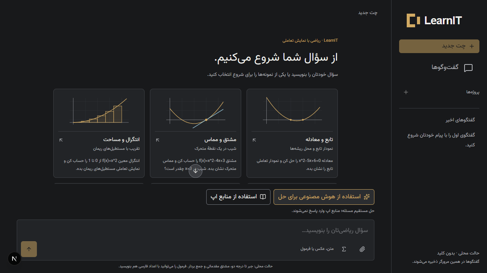
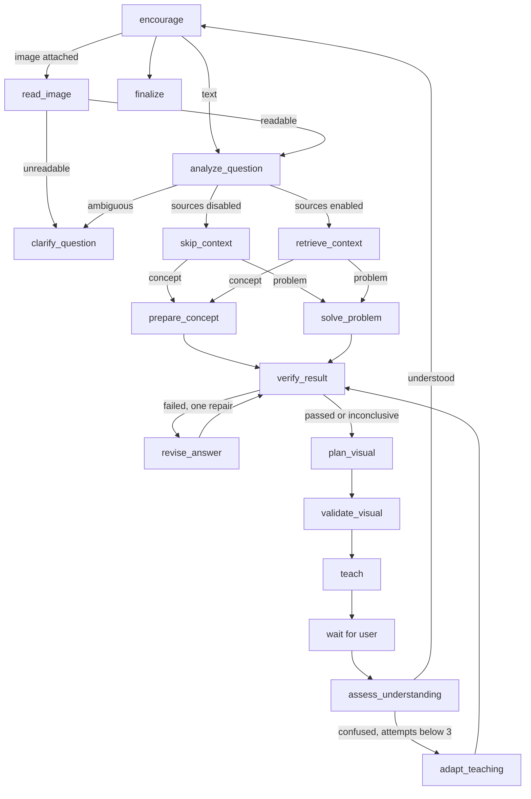

# LearnIT — Complex Mathematics Tutor



Next.js + shadcn/ui، هسته واقعی LangGraph و CLI مشترک. جهت مصوب: گفت‌وگوی تیره، کهربایی و لوگوی C. برنامه در پوشه مستقل است؛ برنامه چت ریشه مخزن را جایگزین نمی‌کند.

## اجرا

Node.js ۲۲ یا بالاتر برای فرمان‌های env-file و Python ۳٫۱۰ یا بالاتر برای CLI پایتون:

```powershell
git clone https://github.com/Alikavoosi21/LearnIT.git
cd LearnIT
npm ci
npm run dev
```

آدرس: http://localhost:3100. برای تولید: `npm run build` سپس `npm start`.

صفحهٔ چت جدید شش نمونهٔ اختیاری از تابع، مشتق، انتگرال، هندسه، بردار و ماتریس همراه پیش‌نمایش بصری دارد. انتخاب نمونه فقط متن سؤال را در ورودی قرار می‌دهد؛ هیچ Agentای پیش از ارسال سؤال اجرا نمی‌شود. بدون تنظیم env، حالت محلی و بدون کلید فعال است. ابزار محلی فقط جمع تک‌جمله‌های ثابت، x و x²، معادله خطی یا درجه دوم و جمع دو بردار دوبعدی را پشتیبانی می‌کند؛ تابع‌های مثلثاتی، کسرها، نامعادله‌ها و پرانتزهای جبری در این ابزار نیستند. تولید توضیح آزاد به اتصال مدل نیاز دارد.

روش پاسخ‌گویی پیش‌فرض «استفاده از هوش مصنوعی برای حل» است و منابع اپ را بازیابی نمی‌کند. با انتخاب «استفاده از منابع اپ»، همان معلم از RAG هم کمک می‌گیرد. این انتخاب در State درس حفظ می‌شود. [تجربه گفتگو و AI Elements](./docs/chat-experience.md) شامل پیمایش گفتگو، نمایش منابع، کپی پاسخ، حفظ سؤال هنگام خطا و تلاش دوباره است.

## اتصال OpenAI

`.env.example` را به `.env.local` کپی کنید و این مقدارها را تنظیم کنید:

```dotenv
TUTOR_MODE=openai
OPENAI_API_KEY=your-key
AI_BASE_URL=https://api.avalai.ir/v1
OPENAI_MODEL=gpt-6-luna
```

مدل انتخابی باید در حساب شما موجود باشد و Responses Structured Outputs را پشتیبانی کند. نام مدل عمداً اجباری و قابل تنظیم است. بعد از تغییر متغیرها سرور را دوباره اجرا کنید. کلید را در مرورگر یا متغیر NEXT_PUBLIC نگذارید. برنامه از Responses API با خروجی Zod، timeout سی‌ثانیه‌ای، یک retry شبکه و `store:false` استفاده می‌کند. تنظیم store:false جایگزین سیاست‌های نگه‌داری داده ارائه‌دهنده نیست.

فایل `.env.example` را به `.env.local` کپی کنید و مقدار `OPENAI_API_KEY` را وارد کنید. این فایل در Git نادیده گرفته می‌شود. [مستندات رسمی Luna](https://developers.openai.com/api/docs/models/gpt-6-luna) پشتیبانی ورودی تصویر و Structured Outputs را اعلام می‌کند. اگر از پروکسی HTTP_PROXY/HTTPS_PROXY استفاده می‌کنید، با Node.js 24 و فرمان `npm run dev:proxy` سرور را اجرا کنید تا درخواست مدل از پروکسی عبور کند.

مدل، تحلیل درخواست، نوشتن آموزش و بازبینی سازگاری را انجام می‌دهد. حل‌گر مستقل برای دامنه محلی به کار می‌رود؛ خارج از این دامنه، پاسخ با وضعیت «تأیید مستقل نشده» ارائه می‌شود. بازبینی مدل اثبات رسمی نیست. بازبینی ناموفق یک بار اصلاح می‌شود؛ اگر در حالت حل مستقیم باز هم رد شد، پیش‌نویس ردشده کنار گذاشته می‌شود و Node recover_ai_answer پاسخ را از محاسبهٔ مستقل بازسازی می‌کند یا یک حل تازه با وضعیت تأیید مستقل نشده تولید می‌کند. دادهٔ ناکافی به سؤال تکمیلی مشخص تبدیل می‌شود. حالت منابع بررسی سخت‌گیرانهٔ قبلی را حفظ می‌کند. اتصال واقعی Luna از طریق AvalAI برای مشتق، مثلث قائم و انتگرال معین آزموده شد؛ انتگرال در هر دو حالت بدون منابع و همراه منابع پاسخ صحیح ۱/۳ داد.

## عکس و صفحه‌کلید ریاضی

دکمه گیره، عکس ثابت PNG، JPEG یا WebP را با حداکثر حجم ۳ مگابایت انتخاب می‌کند. چسباندن عکس از کلیپ‌بورد هم پشتیبانی می‌شود. پیش‌نمایش و حذف قبل از ارسال وجود دارد و ارسال عکس بدون متن مجاز است. نوع واقعی فایل، حجم و سقف ۱۶ میلیون پیکسل در سرور نیز بررسی می‌شود. فایل روی دیسک یا سرویس ذخیره‌سازی آپلود نمی‌شود؛ پیش‌نمایش در حافظه مرورگر است.

برای خواندن عکس، `TUTOR_MODE=openai` و مدل انتخابی دارای قابلیت بینایی و Structured Outputs لازم است. Node جدید `read_image` صورت مسئله را با یک فراخوانی مدل استخراج می‌کند؛ عکس ناخوانا به مسیر رفع ابهام می‌رود. عکس پس از استخراج از State حذف می‌شود و به مراحل حل، RAG یا بازآموزی دوباره ارسال نمی‌شود. توکن خواندن عکس در شمارنده همین سؤال ثبت می‌شود. متن و عکس ارسالی تابع سیاست‌های OpenAI هستند. فراخوانی واقعی بینایی بدون کلید معتبر آزموده نشده است.

[MathLive](https://mathlive.io/mathlive/guides/react/) با مجوز MIT، ویرایشگر فرمول و صفحه‌کلید مجازی را فراهم می‌کند. نمادهای پیشرفته شامل کسر، رادیکال، مشتق، انتگرال، حد، مجموع و ماتریس هستند. پنل از دکمه Σ باز می‌شود و فرمول پس از تکمیل به سؤال اضافه می‌شود. در حالت محلی فرمول به ascii-math و در حالت OpenAI به LaTeX تبدیل می‌شود؛ پشتیبانی از ورود یک نماد به معنی پشتیبانی حل‌گر محلی از آن نیست. کتابخانه هنگام باز کردن پنل بارگذاری می‌شود و فونت‌ها از خود اپ ارائه می‌شوند. استفاده از صفحه‌کلید درخواست مدل ندارد.

## CLI

```powershell
python cli.py 'x^2 - 5x + 6 = 0'
python cli.py 'مشتق چیست؟' --once
python cli.py 'x^2 - 4x + 4 = 0' --json --level beginner
npm run cli -- 'x^2 - 5x + 6 = 0' --once
```

`agent.py` آداپتور پایتون است که یک پردازش Node زنده را نگه می‌دارد. منطق Graph، Nodeها و State در `lib/agent.ts` قرار دارد و میان وب و هر دو CLI مشترک است. بنابراین این نسخه پیاده‌سازی مستقل هسته در Python نیست؛ اگر ارزیاب الزام داشته باشد Graph داخل خود agent.py باشد، این تفاوت باید اعلام شود. حالت تعاملی بعد از جواب، فهمیدم/نفهمیدم/ردکردن را دریافت می‌کند. CLI فرمول را به‌صورت LaTeX متنی نشان می‌دهد؛ نمودار تعاملی در وب است.

## معماری



State با StateSchema و reducer تجمیع trace تعریف شده است؛ Nodeها patch برمی‌گردانند. [Controlled Generative UI](./docs/controlled-generative-ui.md) از CopilotKit برای renderer ثبت‌شده، AI SDK UI برای SSE و LangGraph برای تصمیم‌گیری استفاده می‌کند. توقف برای کاربر به‌صورت وضعیت صریح در سرویس انجام می‌شود؛ این نسخه از interrupt/checkpointer پایدار LangGraph استفاده نمی‌کند. دو درخواست رفع ابهام، یک اصلاح، سه ارائه آموزشی، حداکثر ۱۰ فراخوانی موفق آداپتور و recursionLimit=40 سقف دارند. شمارنده فراخوانی، retry داخلی SDK را شامل نمی‌شود.

Runها در حافظه یک پردازش، با TTL یک ساعت، سقف ۲۰۰ نشست، مالکیت cookie تصادفی HttpOnly، قفل هر Run و eventId تکرارپذیر نگه‌داری می‌شوند. پروژه‌ها و چت‌ها در localStorage همین مرورگر ذخیره می‌شوند و با reload باقی می‌مانند. عکس اصلی فقط در حافظه صفحه است؛ متن خوانده‌شده از آن ذخیره می‌شود. State سرور با restart یا انقضای نشست از بین می‌رود، اما چت ذخیره‌شده با تاریخچهٔ متنی می‌تواند یک نوبت جدید را اجرا کند. برای چند worker، استقرار ابری عمومی، ورود کاربران و همگام‌سازی چند دستگاه باید storage مشترک، احراز هویت و rate limit اضافه شود. این نسخه برای اجرای محلی است.

هر پروژه یک دسته‌بندی ساده از چت‌هاست. منوی چت امکان تغییر نام، انتقال به پروژه و حذف با بازگردانی را دارد. پیام‌های بعدی در همان چت ثبت می‌شوند؛ حداکثر شش پیام اخیر به گراف داده می‌شود. ویرایش آخرین پیام و پاسخ دوباره، نوبت قبلی را پس از دریافت موفق جایگزین می‌کنند. دکمه توقف، درخواست جاری و سیگنال اجرای مدل را لغو می‌کند و متن ورودی حفظ می‌شود.

## ویژوال و توکن

[RAG تنظیم‌شده](./rag/README.md) از ۳۶ بخش معتبر OpenStax و ۵۱۸ قطعه استفاده می‌کند. فقط با فعال‌کردن «استفاده از منابع اپ»، بازیابی BM25 با واژه‌های فارسی/انگلیسی، حداکثر سه قطعه را به حل، آموزش، بررسی و بازآموزی می‌دهد. منابع با لینک، انتساب و مجوز کنار پاسخ نمایش داده می‌شوند. embedding پولی یا جست‌وجوی زنده سراسر وب فعال نیست. متن RAG در حالت OpenAI مصرف توکن ورودی دارد. ایندکس قابل بازسازی با `npm run rag:index` است.

نمودار چندجمله‌ای و بردار از ضرایب و مقدارهای ابزار ساخته می‌شوند. renderer فقط enum و داده محدود معتبر را دریافت می‌کند. تغییر slider، zoom و بازکردن نمودار درخواست مدل ندارد؛ این رفتار در مرورگر آزموده شده است. در نسخه Controlled Generative UI، مدل یک scene از کاتالوگ محدود انتخاب می‌کند؛ محاسبات و تعامل‌های نمایشی محلی‌اند. انتخاب نمایش حداکثر یک فراخوانی ساختاریافته در هر نوبت آموزشی اضافه می‌کند. جابه‌جایی عمودی یک حالت آزمایشی است و جواب مسئله اصلی را عوض نمی‌کند.

هیچ کد مدل با eval اجرا نمی‌شود؛ نمودار از تصویر تولیدشده ساخته نمی‌شود و نقاط sampled به مدل ارسال نمی‌شوند. مصرف ورودی/خروجی OpenAI در State و جزئیات پاسخ ثبت می‌شود. درصد صرفه‌جویی و مصرف زنده هنوز اندازه‌گیری نشده‌اند.

## بررسی

```powershell
npm run typecheck
npm test
npm run test:e2e
npm run build
```

آزمون‌های هسته: ارقام فارسی، معادله دوطرفه، ریشه تکراری و نبود ریشه حقیقی، مشتق و بردار، رد عبارت خارج از parser، جواب خراب، مسیر مفهومی، سقف آموزش، clarification، مالکیت نشست، تکرار event و اصلاح محدود مدل. Playwright با Chrome نصب‌شده، جریان آموزش، بازخورد، نگه‌داری slider هنگام تایپ، صفر درخواست API برای نمودار و موبایل را بررسی می‌کند. تست‌ها را در حالت محلی اجرا کنید؛ حالت OpenAI می‌تواند هزینه داشته باشد.

فونت وزیرمتن با مجوز OFL در public/brand/OFL.txt همراه پروژه است. اجزای UI از CLI رسمی shadcn دریافت شده‌اند. منابع فنی: [LangGraph Graph API](https://docs.langchain.com/oss/javascript/langgraph/quickstart)، [shadcn Next.js](https://ui.shadcn.com/docs/installation/next)، [OpenAI Structured Outputs](https://developers.openai.com/api/docs/guides/structured-outputs). قواعد Next.js از راهنمای داخل بسته نصب‌شده خوانده شده‌اند.
